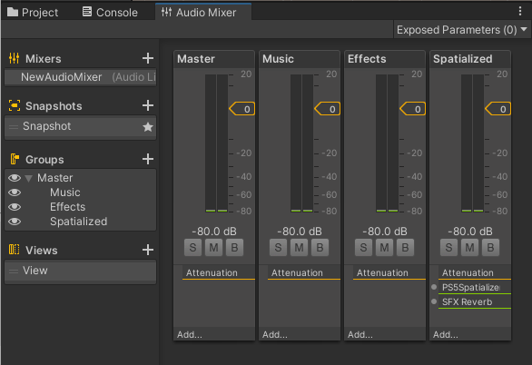

# Best practices and considerations

This section outlines best practices and additional considerations when using the Unity PS5 Spatializer Plug-in.

## Select audio to spatialize

When working with spatialized audio, it’s best to decide early in the build process which audio sources you wish the player to experience in the 3D audio space. For example, diegetic sounds such as character dialogue or an enemy's footsteps work well in the 3D audio space. In contrast, non-diegetic sounds such as music and UI sounds don’t. Also, consider the number of sources that you want to spatialize. For example, spatializing the sound of a small number of approaching enemies can add extra suspense in a horror game. However, if a swarm of enemies is approaching, each audio source would not provide the player with any additional audible information and be a resource heavy operation to run.

## Positioning the audio source in 3D space

3D audio adds the element of height to a player's experience of game audio. With this, consider the placement of the source of any new or existing audio emitting from a GameObject. For example, if adding 3D audio to a project, ensure that character dialogue plays from the character model's head rather than another location on their body.

## Additional considerations

Some configurations may produce a different output in the Editor than on a PS5 device.
For example, when using the Spatial Blend property on a PS5 device, it’s important to note that a separate system is handling the spatialization of the 3D portion of the audio. As this system isn't present when testing in the Editor, you might end up creating setups that don't produce the same sound in the Editor that's produced on a PS5.

Since the sound in the Editor is only an approximation, you must test your mixer and 3D audio source setups on an actual PS5 device.

## Mixer setup example

This example displays a separate subgroup in the mixer dedicated for spatialized audio sources, and the reverb effect used for those sources is on that channel. Other non-spatialized audio sources are routed to the effects subgroup, where more complex effects could be applied.

   

## Limitations

### Number of spatialized audio sources

When using the PS5 spatializer plug-in, a maximum of 64 audio sources can be spatialized at any time. To add support for a larger number of audio sources, increase the variable `kMaxObjectChannels` in `Plugin_Spatializer.cpp`. You must recompile the plugin after any source code change.
