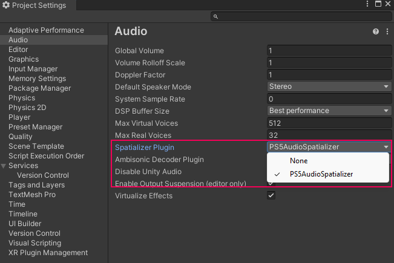
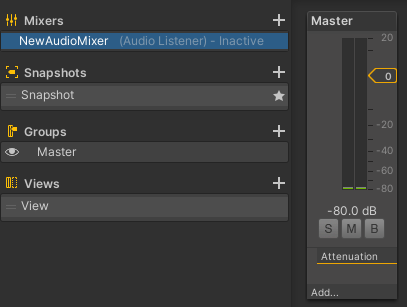
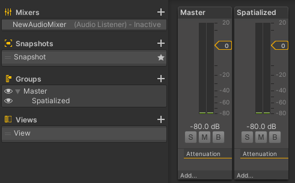
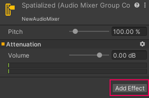
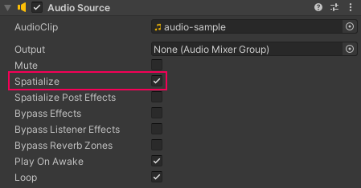
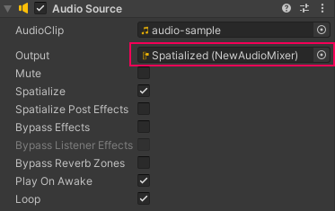
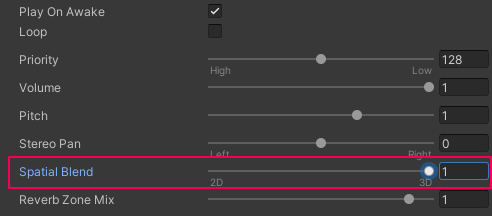
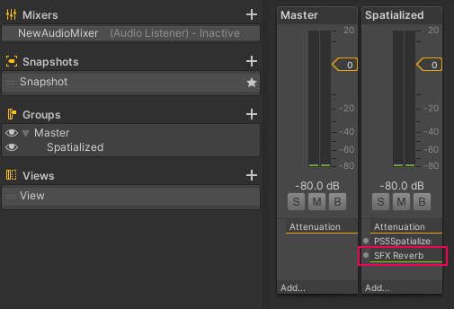
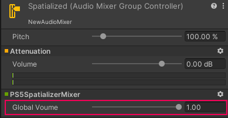

# Getting started

The steps below outline how to set up your project to be able to use spatialized audio in your PlayStation 5 (PS5) title.

## Prerequisites

### Unity version

* This version of the PS5 spatializer package is compatible with Unity Editor 2020.3 and later.
* Install the package using the [Add package from tarball](https://docs.unity3d.com/Manual/upm-ui-tarball.html) option in the package manager.

## Setting up a basic scene

Note: The following steps require a simple scene containing at least a [GameObject](https://docs.unity3d.com/Manual/GameObjects.html) with an attached [audio source](https://docs.unity3d.com/Manual/class-AudioSource.html).

To set up spatialized audio in a project:

1. Select the Spatializer plug-in from the Project Settings audio options:
    * Navigate to **Edit** > **Project Settings** > **Audio**.
    * Set the **Spatializer Plugin** option to **PS5AudioSpatializer**.

    

2. Add an [audio mixer](https://docs.unity3d.com/Manual/AudioMixer.html) to the project to allow direct control of the audio output from your audio sources.
    * Navigate to **Window** > **Audio** > **Audio Mixer**.
    * To add a mixer to the mixers list, select the **Add** (+) button.
    * Provide a name for your mixer.

    A new mixer appears in the Audio Mixer window.

    

3. Add an audio mixer group to specify a separate audio channel for the spatialized audio to pass through. This channel will be used when testing 3D audio in the Editor and when applying effects to your 3D audio when running on device.
    * Navigate to **Window** > **Audio** > **Audio Mixer**.
    * Select the **Add** (+) button to create a new mixer group in the **Groups** section.
    * Provide a group name for your audio mixer.

    

    The new audio mixer group will appear next to the Master group in the audio mixer window.

4. Add the `PS5SpatializerMixer` mixer effect to the newly created mixer group.

    **Note**: This ensures that this mixer only handles the audio data passed through from the **Spatial Blend** option on the audio source.
On the mixer group controller:
    * Select **Add Effect** from the inspector window.

    

    * Select **PS5SpatializerMixer** from the drop-down list.

5. Enable the **Spatialize** option on an audio source you wish to pass into the PS5 3D object audio system.

    

    **Note**: The spatialize option only appears on an audio source when a **Spatializer Plugin** option is selected in the project's audio settings.

    **Tip**: You can also enable the spatializer for an Audio Source through a C# script, using the [`AudioSource.spatialize`](https://docs.unity3d.com/ScriptReference/AudioSource-spatialize.html) property.

6. On the audio source, set the **Output** option to the mixer group with the added **PS5SpatializerEffect** effect in the inspector window.

    

7. Set the desired spatial blend on a spatialized Audio Source. The Unity audio system can retain a percentage of the spatialized audio source using the **SpatialBlend** option.

    

    * A value of 1 passes 100% of the audio through to the PS5 3D object audio system.
    * A value of 0.5 would give 50% of the available audio to the PS5 3D object audio system and 50% to the Unity audio system.

    **Tip**: You can also set the spatial blend property of an Audio Source through a C# script, using the [`AudioSource.spatialBlend`](https://docs.unity3d.com/ScriptReference/AudioSource-spatialBlend.html) property.

## Adding reverb to spatialized audio sources

Use the optional steps below to enhance spatialized audio in your title.

### Adding a reverb effect

You can add effects to your spatialized audio sources by sending  a portion of the audio signal using the Spatial Blend property (as described above) to the Unity mixer. This portion of the signal can be processed with effects such as reverb.

While you can apply effects other than reverb in this way, the resulting sound when mixed with the portion of the signal sent to be spatialized might not sound as expected. It's recommended to only use a reverb effect on this channel.

To add a reverb effect to your spatialized audio group mixer:

1. Select **Add Effect**.
2. Select **SFX Reverb**.

    The reverb effect applies to your spatialized audio group mixer.

    

3. Select the child audio group mixer as the output for each audio source if you wish to apply the reverb effect.

**Warning**: When running your game in the Editor, the Editor is used as the mixer channel to output your 3D audio sources. When running your game on the device, only a portion of your audio sources configured by the spatial blend is passed here, and the PS5’s 3D audio systems process the rest. The resulting overall sound will differ when running on a PS5.

### Set global volume

Place the PS5SpatializerMixer effect on a mixer to enable the **Global Volume** option in the mixer inspector.

The Global Volume setting lets you control the volume of all spatialized audio passing through this mixer. It allows for more dynamic control, such as muting all spatialized audio in a scene. You can also expose this parameter using a script, and control using snapshots. For more information, see [AudioGroup Inspector](https://docs.unity3d.com/2023.1/Documentation/Manual/AudioMixerInspectors.html).

## Experience 3D audio

After following the above steps, when you enter the Play Mode, you can still experience audio in your scene. To experience the full 3D audio effect, you will need to create a build of your project and run this on your PS5 development kit.

