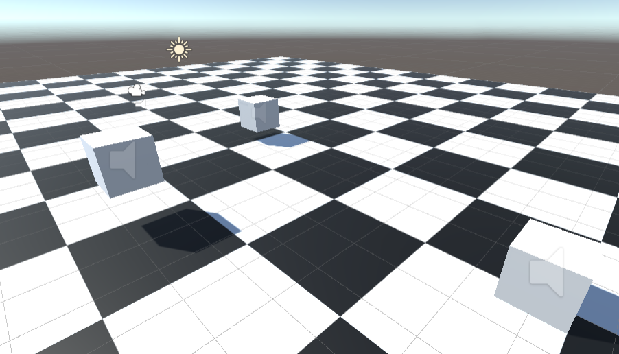
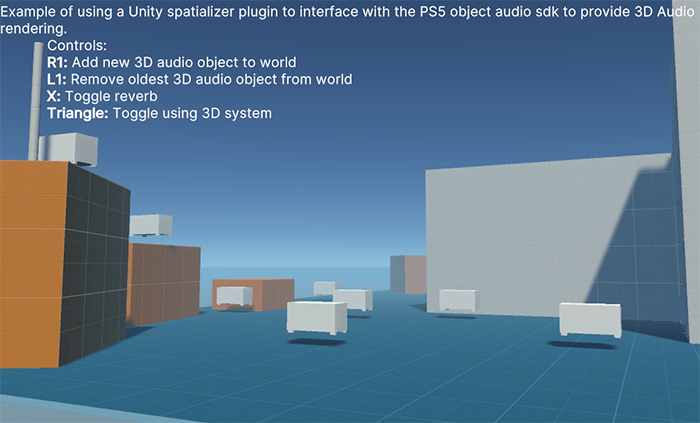

# Use the sample projects

The below section describes how to use and navigate the provided PlayStation 5 (PS5) spatializer sample projects. You can run these samples in the Editor, but to hear the full effect of spatialized audio, you must run them on a PS5.

## Access the sample projects

The Spatializer plug-in comes with a sample project containing two scenes for you to explore. After installing the package, import the sample from the Package Manager. You can then access the sample projects from the **Assets** window under **Samples**.

## PS5 input system package

You must install the latest [PS5 input system package](https://game.develop.playstation.net/forums/thread/201117/) to use the sample. This package adds support for the DualSense gamepad.

## Sample projects

### Basic Sample

The basic sample project allows you to navigate a scene from a first-person view (FPV). The scene contains three game objects that stream different audio files on a loop; a piece of music, a speech, and the sound of a helicopter. You can hear how the audio behaves inside this 3D environment as you move around, and see how a basic scene is set up.

### One Shot

The one-shot sample shows how to use spatialized audio with the audio source `playoneshot` method. Much like the basic sample project, the one-shot sample project lets you navigate a 3D space. It lets you spawn and destroy 3D audio objects on demand, toggle the use of the 3D audio system, enable or disable the reverb effect, and enable or disable the use of the spatial blend slider.

You can interact with the sample using the following controls:

|**Binding**|**Action**|
|--|--|
|**R1**|Adds a new 3D audio object to the environment.|
|**L1**|Removes a 3D audio object from the environment, starting with the oldest object placed.|
|**Cross**|Toggle the use of the reverb effect.|
|**Triangle**|Toggles the use of the 3D audio system.|
|**Left/Right directional button** |Changes the value of the spatial blend in use.|
